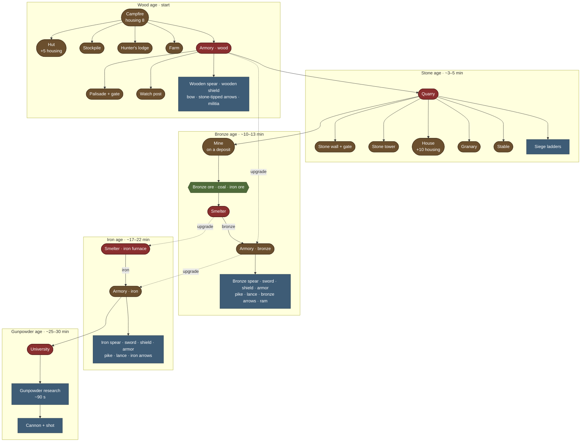
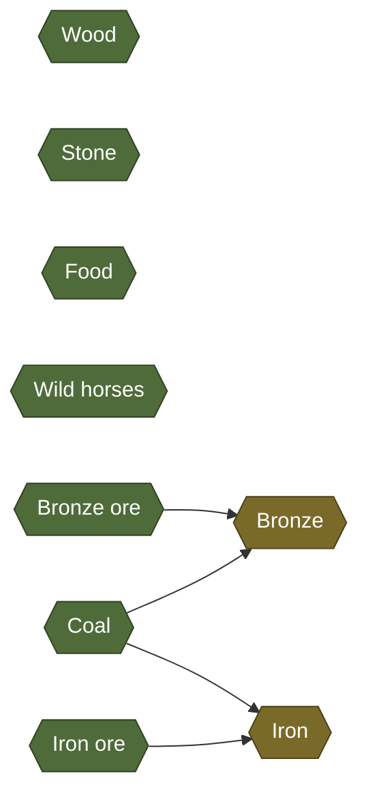
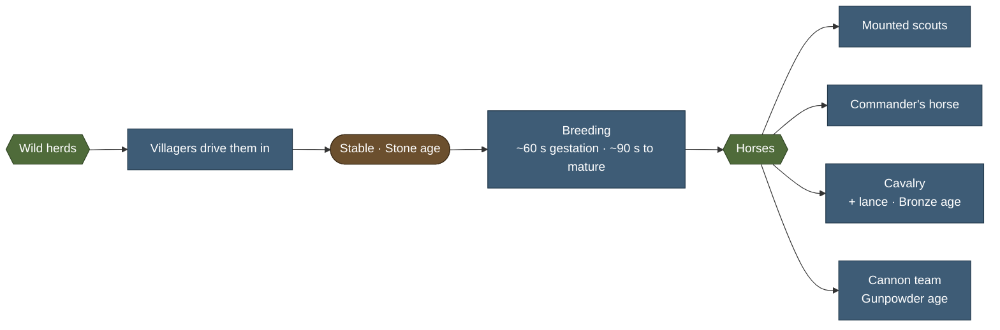
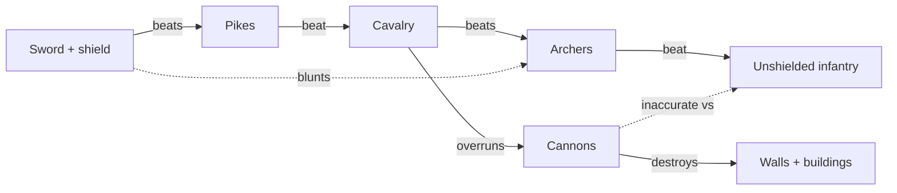

# MarchHold — Tech Tree

Companion to [PLAN.md](PLAN.md) §6–8. Costs and exact timings are not set yet; the times shown are pacing targets.

**Viewing:** VS Code needs the "Markdown Preview Mermaid Support" extension, then Ctrl+Shift+V. GitHub draws these automatically.

**Legend:** rounded = building · square = item / unit · hexagon = resource

## Full tree

Red buildings are the ones that open the next age. Dotted arrows are upgrades in place.

## Resources

## Horses

## Combat matchups

