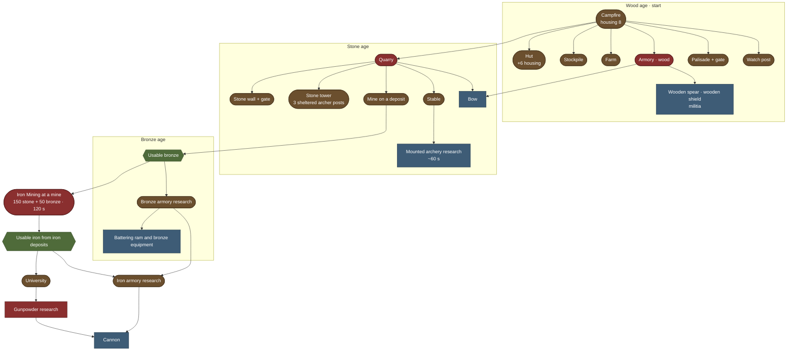
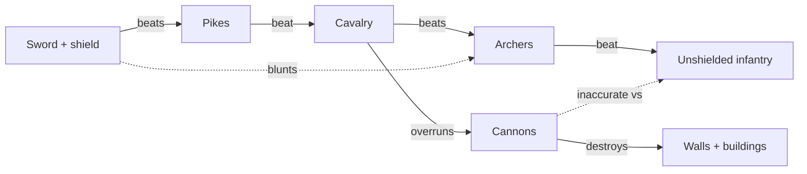

# MarchHold — Tech Tree

Normal starts in the Wood age. Grand Army starts with every research project complete. Both modes use the same buildings and recipes.

**Viewing:** VS Code needs the "Markdown Preview Mermaid Support" extension, then Ctrl+Shift+V. GitHub draws these automatically.

**Legend:** rounded = building · square = item / unit · hexagon = resource

## Full tree

Every mine produces the usable metal in its deposit. Iron Mining unlocks iron for the whole settlement. Armory research expands the recipes at every armory. Bows become available in the Stone age, and archers and cannons can fire throughout a battle without resupply.

## Horses

## Combat matchups

